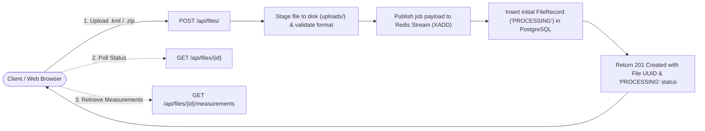
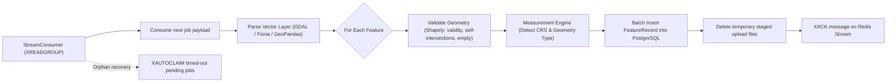

# Geospatial File Measurement API & Console

A high-performance FastAPI and React web service that ingests geospatial vector files (`.kml` Keyhole Markup Language and `.zip` ESRI Shapefiles), extracts features with source attributes, validates geometric topology, and computes accurate geographic measurements (area, perimeter, and length) using geodesic ellipsoidal or projected planar methods.

The application serves both the interactive React web console and REST API on **port 8000**.

---

## Demo

https://github.com/user-attachments/assets/b47baaf6-1325-4b69-9bfb-b31a60ef4a8b

---

## Architecture & System Design

### 1. Application Structure

```
geospatial-file-measurement/
├── app/
│   ├── api/
│   │   ├── controllers/         # FastAPI route controllers (/api/files)
│   │   └── contract/            # Request and Response schemas (Pydantic v2)
│   ├── db/
│   │   ├── database.py          # Async SQLAlchemy engine & sessionmaker (PostgreSQL)
│   │   └── models.py            # FileRecord and FeatureRecord ORM models
│   ├── exceptions/              # Domain-specific HTTP exceptions & handlers
│   ├── queue/
│   │   ├── producer.py          # Redis Streams message producer (XADD)
│   │   └── consumer.py          # Redis Streams consumer group worker (XREADGROUP, XAUTOCLAIM)
│   ├── repositories/
│   │   └── file_repository.py   # Async database repository pattern
│   ├── services/
│   │   ├── cache_service.py     # Redis caching for measurement pagination
│   │   ├── geometry_validator.py # Topological & geometric validation via Shapely
│   │   ├── measurement_engine.py # Geodesic (PyProj WGS84) & planar calculations
│   │   └── measurement_service.py # File staging, archive extraction, coordinate parsing
│   ├── main.py                  # App entry point, static asset mounts, SPA catch-all
│   └── worker.py                # Standalone background consumer process
├── frontend/                    # React 19 + TypeScript + Vite + Tailwind Console
│   ├── src/
│   │   ├── components/          # Modular UI components (Upload, Lookup, Metadata, Table)
│   │   └── App.tsx              # Root dashboard coordinator
│   └── vite.config.ts           # Build bundle config and dev API proxy
├── tests/                       # Automated pytest test suites (29 tests)
├── Dockerfile                   # Multi-stage build (Node build -> Python runtime)
├── docker-compose.yml           # Multi-container orchestration (API, Worker, Postgres, Redis)
└── requirements.txt             # Python dependencies
```

---

### 2. Processing & Calculation Flow

**Usual processing flow**


**Background worker flow**



---

### 3. Measurement Calculation Flow & Metric Assignment

Geospatial measurements depend fundamentally on geometry dimension:

| Geometry Type | Supported Metrics | `area_sq_m` | `perimeter_m` | `length_m` | Calculation Method |
| :--- | :--- | :---: | :---: | :---: | :--- |
| **Polygon / MultiPolygon** | 2D Area & Boundary Perimeter | $\text{Value } (m^2)$ | $\text{Value } (m)$ | `null` | `GEODESIC_WGS84` or `PROJECTED_PLANAR` |
| **LineString / MultiLineString** | 1D Trajectory Length | `null` | `null` | $\text{Value } (m)$ | `GEODESIC_WGS84` or `PROJECTED_PLANAR` |
| **Point / MultiPoint** | 0D Location (Zero dimension) | `null` | `null` | `null` | `NONE` |
| **Invalid / Empty** | Topological defect (e.g. self-intersection) | `null` | `null` | `null` | `null` (Flagged with diagnostics) |

---

### 4. Coordinate Reference System (CRS) Handling

1. **Geographic Coordinates (e.g. WGS84 / EPSG:4326):**
   - Coordinates represent angular degrees $(\text{longitude}, \text{latitude})$.
   - Planar Euclidean calculations in degrees produce distorted, incorrect values.
   - The engine utilizes ellipsoidal geodesic algorithms via **PyProj `Geod(ellps="WGS84")`**:
     - `geod.geometry_area_perimeter(geom)`: Computes true geodesic surface area and perimeter in meters.
     - `geod.geometry_length(geom)`: Computes great-circle ellipsoidal length in meters.
2. **Projected Planar Coordinates (e.g. UTM, Web Mercator / EPSG:3857):**
   - Coordinates are planar Cartesian units projected in meters.
   - Calculated directly via planar geometry: `geom.area` and `geom.length`.
3. **Missing or Ambiguous CRS:**
   - KML defaults to standard WGS84 (`EPSG:4326`).
   - If an ESRI Shapefile archive lacks a `.prj` definition or cannot be resolved, features are recorded with `measurement_method = null` to prevent erroneous metrics.

---

## Design Decisions & Trade-offs

| Decision | Selected Approach | Alternative Considered | Rationale |
| :--- | :--- | :--- | :--- |
| **Framework Choice** | FastAPI | Django / Django REST Framework | FastAPI provides native async/await concurrency, automatic OpenAPI/Swagger documentation, and minimal footprint without the overhead of Django's heavy ORM, admin site, and synchronous defaults. |
| **Containerization** | Multi-container Docker Compose | Bare-metal local setup | Geospatial dependencies (C-libraries like GDAL, GEOS, PROJ) often fail or differ across host OSs (especially Windows vs Linux). Docker encapsulates system binaries, PostgreSQL, and Redis into reproducible, zero-configuration environments. |
| **Unified Port :8000** | Multi-stage Docker build; FastAPI serves React static build & SPA fallback | Running separate Node container (port 5173) with Nginx proxy | Simplifies local development, container orchestration, and eliminates CORS complexity. |
| **Queue Architecture** | Redis Streams (`XADD`, `XREADGROUP`, `XAUTOCLAIM`) | Celery / RabbitMQ or Kafka | Zero heavy JVM or broker dependencies. Consumer groups provide built-in acknowledgment and crash-resilient auto-claiming of orphaned jobs. |
| **Spatial Validation** | Shapely `is_valid` with `explain_validity` | PostGIS spatial queries directly in DB | In-memory evaluation prior to insertion eliminates database round-trips and surfaces detailed topological error messages. |
| **Database Access** | SQLAlchemy 2.0 Async + asyncpg | Synchronous psycopg2 / Django ORM | Non-blocking database I/O allows high-throughput metadata and measurement queries concurrently with background processing. |

---

## Local Setup & Execution

### Prerequisites
- [Docker](https://www.docker.com/) & Docker Compose
- *Optional for local dev without Docker:* Python 3.11+, Node.js 20+, PostgreSQL 16, Redis 7

### 1. Running with Docker Compose (Recommended)

1. Clone repository and navigate to root:
   ```bash
   git clone <repo-url>
   cd geospatial-file-measurement
   ```

2. Start all services:
   ```bash
   docker compose up -d --build
   ```

3. Open in browser:
   - **Interactive Web UI:** `http://localhost:8000/`
   - **Swagger API Docs:** `http://localhost:8000/docs`

4. Inspect logs:
   ```bash
   docker compose logs -f
   ```

5. Stop services:
   ```bash
   docker compose down
   ```

---

### 2. Running Locally (Without Docker)

1. **Start PostgreSQL and Redis:**
   Ensure PostgreSQL is running on port 5432 and Redis on port 6379.

2. **Configure environment variables:**
   ```bash
   cp .env.example .env
   ```

3. **Install Python backend dependencies:**
   ```bash
   python -m venv .venv
   source .venv/bin/activate  # On Windows: .venv\Scripts\Activate.ps1
   pip install -r requirements.txt
   ```

4. **Build the frontend:**
   ```bash
   cd frontend
   npm install
   npm run build
   cd ..
   ```

5. **Start the API service:**
   ```bash
   uvicorn app.main:app --host 0.0.0.0 --port 8000 --reload
   ```

6. **Start the background worker in a separate terminal:**
   ```bash
   python -m app.worker
   ```

---

## Running the Automated Test Suite

Run the full pytest suite (29 tests) inside the Docker container:

```bash
docker exec geospatial_api python -m pytest -v
```

Or locally in your virtual environment:

```bash
python -m pytest -v
```

**Test Coverage Highlights:**
- KML document and ZIP Shapefile ingestion flows.
- Self-intersecting bowtie polygons and null/empty geometry detection.
- Geodesic (WGS84 ellipsoidal) and projected planar area and length computations.
- Redis stream job publishing, consumer group acknowledgment, and auto-claiming.
- REST API upload, metadata retrieval, pagination, and error responses.

---

## REST API Documentation

### 1. Health Check
`GET /health`

**Response (200 OK):**
```json
{
  "status": "healthy"
}
```

---

### 2. Upload Geospatial File
`POST /api/files/`

**Headers:** `Content-Type: multipart/form-data`  
**Body:** Form field `file` (`.kml` or `.zip` containing `.shp`, `.shx`, and `.dbf`).

**Example Request (cURL):**
```bash
curl -X POST "http://localhost:8000/api/files/" \
  -H "accept: application/json" \
  -F "file=@sample_polygon.kml"
```

**Response (201 Created):**
```json
{
  "id": "e932ec34-5858-45fa-bb26-dcaeb97105cb",
  "filename": "sample_polygon.kml",
  "file_size": 1420,
  "source_crs": "EPSG:4326",
  "feature_count": 0,
  "status": "PROCESSING",
  "error_message": null,
  "created_at": "2026-10-11T12:00:00.000000Z"
}
```

---

### 3. Retrieve File Processing Status & Metadata
`GET /api/files/{id}`

**Example Request:**
```bash
curl -X GET "http://localhost:8000/api/files/e932ec34-5858-45fa-bb26-dcaeb97105cb"
```

**Response (200 OK):**
```json
{
  "id": "e932ec34-5858-45fa-bb26-dcaeb97105cb",
  "filename": "sample_polygon.kml",
  "file_size": 1420,
  "source_crs": "EPSG:4326",
  "feature_count": 2,
  "status": "COMPLETED",
  "error_message": null,
  "created_at": "2026-10-11T12:00:00.000000Z"
}
```

---

### 4. Retrieve Computed Feature Measurements
`GET /api/files/{id}/measurements?page=1&page_size=10`

**Example Request:**
```bash
curl -X GET "http://localhost:8000/api/files/e932ec34-5858-45fa-bb26-dcaeb97105cb/measurements?page=1&page_size=10"
```

**Response (200 OK):**
```json
{
  "items": [
    {
      "feature_index": 0,
      "geometry_type": "Polygon",
      "properties": {
        "Name": "Agricultural Parcel 4A",
        "Owner": "State Dept"
      },
      "validation_status": "VALID",
      "validation_message": null,
      "area_sq_m": 12309.0721,
      "perimeter_m": 443.7875,
      "length_m": null,
      "measurement_method": "GEODESIC_WGS84",
      "measurement_crs": "EPSG:4326"
    },
    {
      "feature_index": 1,
      "geometry_type": "LineString",
      "properties": {
        "Name": "Access Road Segment",
        "SpeedLimit": 45
      },
      "validation_status": "VALID",
      "validation_message": null,
      "area_sq_m": null,
      "perimeter_m": null,
      "length_m": 1248.5134,
      "measurement_method": "GEODESIC_WGS84",
      "measurement_crs": "EPSG:4326"
    }
  ],
  "total": 2,
  "page": 1,
  "page_size": 10,
  "pages": 1
}
```

---

## Learnings & Key Takeaways

1. **Dimensional Integrity in Geospatial APIs:**
   - Differentiating metrics by dimension (surfaces have area/perimeter, linear features have length, points have neither) prevents conflating 1D and 2D spatial concepts and avoids misleading zero-values.
2. **Ellipsoidal Geodesics vs. Planar Projections:**
   - Computing Euclidean distance on unprojected degrees introduces severe distortion as latitude deviates from the equator. Geodesic computations using PyProj `Geod` provide millimeter-level surface accuracy without needing to pick local UTM projection zones.
3. **Asynchronous Stream Consumer Resilience:**
   - Combining Redis Streams consumer groups (`XREADGROUP`) with orphan-claiming (`XAUTOCLAIM`) enables worker crash-resilience without complex broker infrastructure.

---

## Future Scope & Enhancements

- **Real-Time Completion Notifications:** Introduce a completion event producer where the worker publishes a notification upon finishing file processing, and a client-facing consumer (via WebSockets or Server-Sent Events / SSE) that pushes updates to automatically transition file status and refresh measurements on the frontend without interval polling.
- **Interactive Leaflet / MapLibre Preview:** Render geospatial features and their boundaries on an interactive slippy map in the frontend console.
- **Additional Vector & Raster Formats:** Expand ingestion support to GeoJSON, FlatGeobuf, GeoPackage (`.gpkg`), and Cloud Optimized GeoTIFF (COG).
- **Chunked & Streaming Multi-Part Uploads:** Support S3 presigned direct uploads for vector archives exceeding 500 MB.
- **Auto-Reprojection Options:** Provide client options to request measurements reprojected to user-specified local projection systems (e.g. State Plane or specific UTM zones).
- **Exporting Metrics:** Enable CSV and GeoJSON export of validated features with computed metrics directly from the UI.
