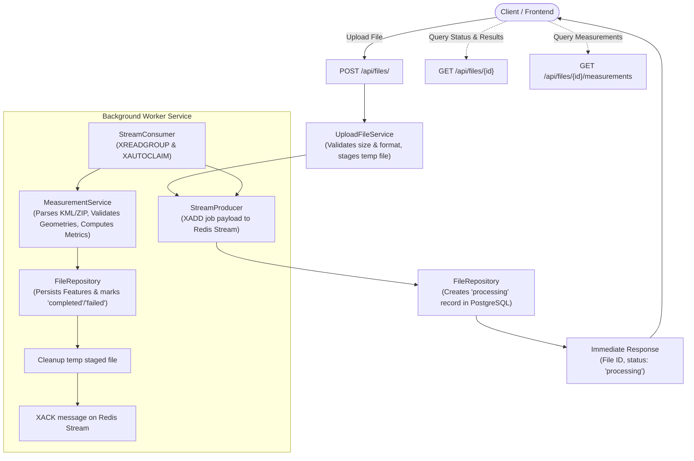

# Geospatial File Measurement API

A production-ready FastAPI backend that ingests geospatial vector files (`.kml` and `.zip` ESRI Shapefiles), extracts features and source attributes, validates geometries, and computes accurate geographic measurements (area, perimeter, and length) using geodesic or projected planar methods.

---

## Features

- **Format Ingestion:** 
  - Standard Keyhole Markup Language (`.kml`) via GDAL / Fiona KML & LIBKML drivers.
  - ESRI Shapefile archives packaged as `.zip` containing mandatory `.shp`, `.shx`, and `.dbf` files.
- **Robust Validation:**
  - Geometry validation via Shapely: detects null/empty geometries, unsupported geometry collections, and topological invalidities (e.g., self-intersecting bowtie polygons) with detailed diagnostic messages.
  - Coordinate Reference System (CRS) validation: inspects source CRS before measuring.
- **Accurate Geographic Measurements:**
  - **Geographic CRS (e.g. WGS84 / EPSG:4326):** Uses ellipsoidal geodesic algorithms via PyProj `Geod(ellps="WGS84")` for true Earth-surface area ($m^2$) and length ($m$), avoiding projection distortion.
  - **Projected CRS (e.g. UTM, Web Mercator / EPSG:3857):** Calculates planar area and perimeter directly in meters.
  - **Points & Multipoints:** Handled explicitly with `method="NONE"` and `null` measurements.
  - **Invalid Geometries:** Excluded from calculation without failing the entire file.
- **Persistence & Retrieval:**
  - Async PostgreSQL database (SQLAlchemy 2.0 + asyncpg) storing file metadata and per-feature measurements.
  - REST endpoints for file uploads, file metadata retrieval, and paginated measurement querying.
- **Crash-Resilient Asynchronous Queue:**
  - Zero-JVM Redis Streams queueing for large files.
  - Background worker consuming via consumer groups (`XREADGROUP`) and auto-claiming crashed/orphaned tasks (`XAUTOCLAIM`).
- **Security & Reliability:**
  - 50 MB upload limit.
  - Zip-Slip path traversal protection on extracted archives.
  - Temporary file cleanup after processing.
  - Multi-service Docker container setup (API, Worker, PostgreSQL, Redis).

---

## Architecture & Processing Flow



---

## API Endpoints

### 1. Health Check
`GET /health`
```json
{
  "status": "healthy"
}
```

### 2. Upload Geospatial File
`POST /api/files/`

**Request:** `multipart/form-data` with field `file` (`.kml` or `.zip`).

**Example cURL:**
```bash
curl -X POST "http://localhost:8000/api/files/" \
  -H "accept: application/json" \
  -F "file=@sample_polygon.kml"
```

**Response (201 Created):**
```json
{
  "id": "e932ec34-5858-45fa-bb26-dcaeb97105cb",
  "filename": "sample_polygon.kml",
  "file_size": 1420,
  "source_crs": "EPSG:4326",
  "feature_count": 1,
  "status": "COMPLETED",
  "error_message": null,
  "created_at": "2026-10-10T15:24:00.000000Z"
}
```

### 3. Retrieve File Metadata
`GET /api/files/{id}/`

**Example cURL:**
```bash
curl -X GET "http://localhost:8000/api/files/e932ec34-5858-45fa-bb26-dcaeb97105cb/"
```

### 4. Retrieve Feature Measurements
`GET /api/files/{id}/measurements/?page=1&page_size=50`

**Response (200 OK):**
```json
{
  "items": [
    {
      "feature_index": 0,
      "geometry_type": "Polygon",
      "properties": {
        "Name": "Parcel A"
      },
      "validation_status": "VALID",
      "validation_message": null,
      "area_sq_m": 12309.0721,
      "perimeter_m": 443.7875,
      "length_m": null,
      "measurement_method": "GEODESIC_WGS84",
      "measurement_crs": "EPSG:4326"
    }
  ],
  "total": 1,
  "page": 1,
  "page_size": 50,
  "pages": 1
}
```

---

## Running Locally & With Docker

### Docker Compose (Recommended)

1. Start the service:
```bash
docker compose up -d --build
```

2. View container logs:
```bash
docker compose logs -f
```

3. Explore interactive Swagger documentation:
Visit `http://localhost:8000/docs`.

### Running Tests

Run the comprehensive pytest suite inside the container:
```bash
docker exec geospatial_api python -m pytest -v
```
All 23 automated tests cover:
- KML and ZIP Shapefile ingestion.
- Bowtie self-intersection and empty geometry validation.
- Geodesic and planar area and length algorithms with numerical tolerances.
- REST API upload, metadata retrieval, pagination, and error cases (404, 415).
